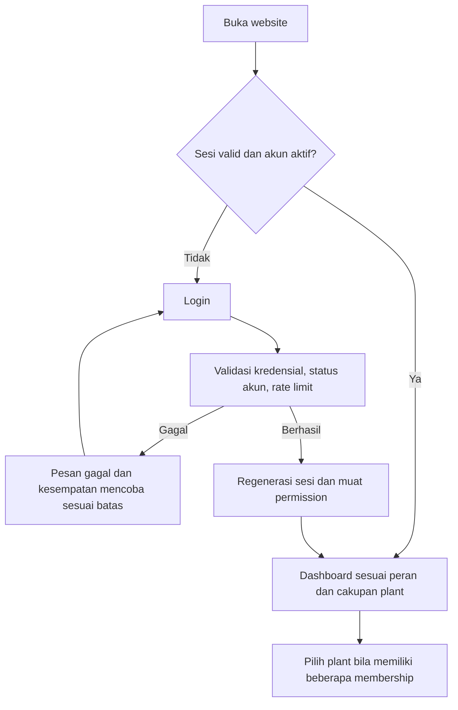
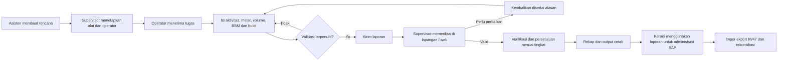
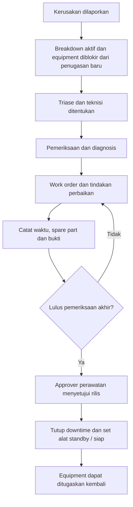
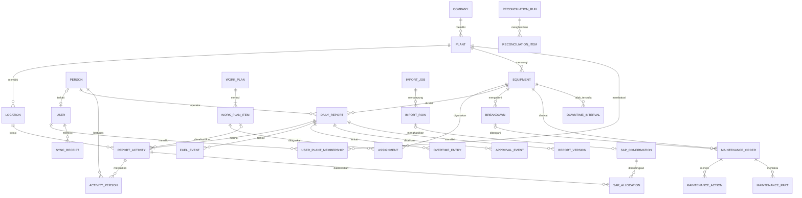
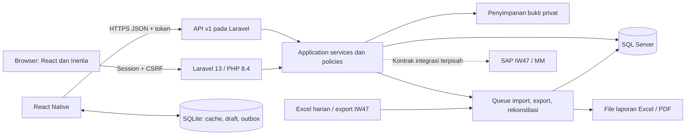
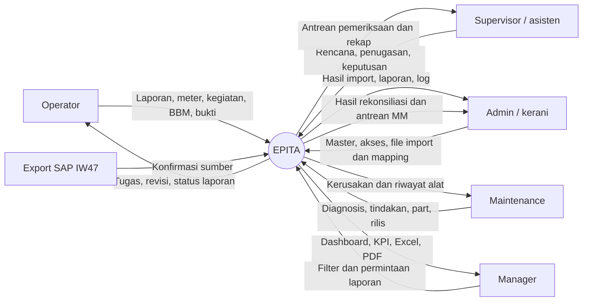
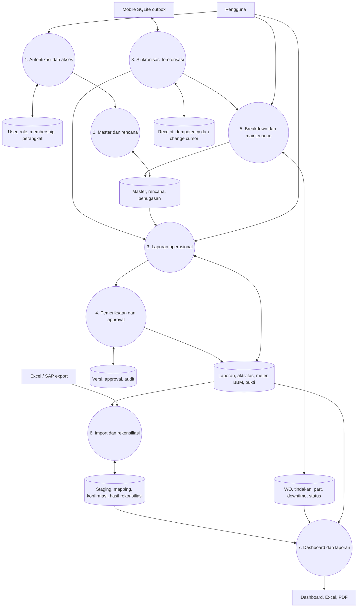

# PRD — EPITA
## Sistem Operasional Alat Berat, Kendaraan, dan Mesin Berbahan Bakar

**Versi:** 1.0  
**Tanggal:** 22 Oktober 2026  
**Bahasa produk:** Bahasa Indonesia  
**Jenis dokumen:** spesifikasi produk untuk pengembangan; bukan prototipe atau pernyataan bahwa sistem sudah tersedia.  
**Nama EPITA:** nama kerja yang mengikuti referensi desain pengguna; dapat diganti tanpa mengubah kebutuhan bisnis.

**Panduan baca:**

- Produk dan data sumber: bagian 1–4.
- Role, menu dan flow: bagian 5–7.
- Fitur, field dan perhitungan: bagian 8–9.
- Semua format output foto: bagian 10.
- SAP, ERD, arsitektur, API dan offline: bagian 11–15.
- Desain, pengujian, UAT dan keputusan go-live: bagian 16–20.

---

## 1. Ringkasan produk

EPITA menyatukan master alat, penugasan, aktivitas harian, pencatatan meter, operator/helper, volume pekerjaan, bahan bakar, persetujuan, kerusakan, maintenance, dan laporan manajemen. Website melayani administrasi dan pengawasan; aplikasi mobile melayani pencatatan lapangan, termasuk saat koneksi terputus.

Setelah login berhasil, pengguna **langsung masuk ke dashboard sesuai peran dan plant**. Tidak diperlukan landing page pemasaran atau registrasi publik.

Aktivitas operasional VRA dan maintenance merupakan **dua domain berbeda**. Keduanya mengacu ke equipment yang sama, tetapi mempunyai transaksi, penanggung jawab, workflow, dan laporan sendiri. BBM mempunyai hubungan ke pelaporan operasional; pengelolaan transaksi material dan posting SAP MM menjadi batas integrasi tersendiri.

### 1.1 Keputusan yang sudah ditetapkan pengguna

| Keputusan | Ketentuan |
|---|---|
| Backend dan API | PHP 8.4 + Laravel 13, dalam backend yang sama |
| Frontend website | React + Inertia |
| Mobile | React Native, menggunakan API Laravel |
| Database web | SQL Server |
| Database lokal mobile | SQLite |
| Halaman setelah login | Dashboard, mengikuti kewenangan pengguna |
| Pemisahan proses | Maintenance berbeda dari aktivitas alat/VRA |
| Format output | Semua format laporan pada foto, bukan hanya satu foto |
| Makna BBM pada Excel | Harus diverifikasi **per laporan**; tidak boleh diasumsikan selalu diisi atau selalu dipakai |
| Deliverable percakapan ini | PRD dan prompt pengembangan saja; tanpa pembuatan prototipe |

### 1.2 Status kebutuhan dalam dokumen

- **Wajib:** berasal dari kebutuhan pengguna atau diperlukan agar workflow tersebut benar.
- **Usulan:** keputusan desain yang dapat dipakai tim sebagai default, tetapi perlu pengesahan pemilik proses sebelum go-live.
- **Konfirmasi:** arti data atau kebijakan belum dapat ditentukan dari sumber. Sistem menyediakan antrean pemeriksaan, bukan mengarang nilainya.

Isi Excel, foto, diagram, dan screenshot diperlakukan sebagai bahan referensi. Catatan di dalamnya tidak otomatis menjadi instruksi untuk mengeksekusi tindakan, mengubah akses, atau menyalin mekanisme keamanan yang kurang tepat.

## 2. Sumber data dan hasil pemeriksaan

### 2.1 Inventaris sumber

| Sumber | Peran dalam spesifikasi |
|---|---|
| `09. Laporan Harian Alat Berat Update September  2026 (1).xlsx` | Struktur buku harian alat berat, HM awal/akhir, lokasi, BBM, uraian, volume/satuan, operator/helper, dan rekap |
| `EXPORT IW47 VRA AGT 2026 - Updated (1).xlsx` | Kontrak kolom impor IW47, identitas konfirmasi, actual work, quantity, personel, order, activity, dan informasi pembatalan |
| Screenshot 10.11.47–10.12.33 | Arsitektur, organisasi, master, flow, dan palet warna |
| Screenshot 10.12.47 dan 10.12.52 | Referensi form harian dan pemetaan kolom Excel |
| Screenshot 10.13.17 | Arah visual login, dashboard, rencana, penugasan, persetujuan, maintenance, laporan, dan master |
| Screenshot SAP pada gambar clipboard | Hubungan order, operation/activity, confirmation/counter, work center, actual work, dan posting date |
| WhatsApp 08.34.39 dan 08.34.46 | Buku kendaraan dengan banyak perjalanan, kilometer, jam, muatan, lembur, pengisian BBM, dan pengesahan |
| WhatsApp 08.34.44 | Buku kendaraan mingguan dengan subtotal minggu dan total periode |
| WhatsApp 08.34.41 | Laporan mesin Yanmar, sesi pagi/sore, solar dan kumulatif |
| WhatsApp 08.34.43 | Laporan genset Cummins 60 KVA, jam pemanasan, konsumsi solar, rasio, kumulatif dan pengesahan |

Foto merupakan referensi struktur output. Transkripsi angka tulisan tangan belum disahkan dan tidak boleh dipakai sebagai fakta operasional tanpa pemeriksaan manusia. Nomor polisi dan nama pada foto boleh menjadi kandidat master, tidak otomatis menjadi identitas equipment final.

### 2.2 Temuan faktual Excel

| Pemeriksaan | Hasil |
|---|---|
| Worksheet dalam file harian | 22 worksheet, termasuk rekap dan daftar operator |
| Baris dengan tanggal pada kolom pertama | 149 baris; angka ini bukan jumlah laporan final |
| Periode tanggal dalam file harian | September 2026: 85 baris; Juli 2026: 62 baris; Desember 2024: 2 baris |
| Periode utama September yang teramati | 1–5 September 2026; jangan tampilkan sebagai satu bulan yang sudah lengkap |
| Kode yang dipakai beberapa sheet | `EXC3300000000007` muncul di `Exc 320 - (02)`, `Exc 320 - (3)`, dan `Exc 320-(02)` |
| Baris tanpa kode equipment teridentifikasi | 41 baris tanggal |
| Baris dengan meter awal/akhir tidak lengkap | 53 baris tanggal |
| Baris berisi BBM yang artinya perlu diperiksa | 79 baris tanggal |
| Worksheet dengan rentang format sangat besar | `Excamini 305(5)` menyatakan hingga baris 1.048.549; jangan menganggap seluruh rentang sebagai transaksi |
| Struktur IW47 | 1 worksheet, 36 kolom |
| Baris detail IW47 dengan Confirmation dan Equipment | 1.798 baris |
| Equipment unik pada detail IW47 | 83 equipment |
| Distribusi satuan detail IW47 | Hm: 718 baris; Km: 945 baris; H: 135 baris |
| Posting Date pada detail IW47 | 1–31 Agustus 2026 |
| Nilai `Cancelled Confirm.` nonnol | 16 baris, perlu penyelesaian semantik pembatalan SAP |
| Baris non-detail IW47 | 87 baris subtotal/total atau tanpa identitas konfirmasi; termasuk subtotal equipment |

**Implikasi implementasi:**

1. Jangan mencocokkan Agustus dan September sebagai periode yang sama.
2. Jangan memasukkan subtotal/total Excel sebagai detail baru: hal ini menggandakan hasil rekap.
3. Jangan menyatukan dua alat hanya karena kode pada sheet sama; buat konflik master untuk diperiksa.
4. Jangan memperlakukan meter kosong sebagai nol, atau ketidakhadiran transaksi sebagai standby.
5. Nilai `Cancelled Confirm.` dapat berupa referensi/counter pembatalan. Pertahankan nilai mentah. Jangan berasumsi setiap nilai nonnol adalah boolean sederhana yang cukup untuk menghitung nilai bersih.
6. Jumlah temuan kualitas data dapat tumpang tindih: satu baris bisa memiliki beberapa masalah.
7. HM adalah selisih hour meter; jam kerja dari waktu mulai/selesai adalah pengukuran berbeda.

### 2.3 Contoh pemetaan yang benar-benar ada pada sumber

File harian, sheet `Excamini 305(01)`, baris 8:

| Field | Nilai sumber | Perlakuan |
|---|---|---|
| Equipment | `EXC3300000000003` | Simpan teks; cocokkan dengan master yang telah disahkan |
| Tanggal | 1 September 2026 | Tanggal aktivitas, bukan tanggal unggah |
| HM awal | 10.023 | Nilai numerik 10023 |
| HM akhir | 10.030 | Nilai numerik 10030 |
| Jumlah HM | 7 | Bandingkan dengan hasil akhir − awal |
| Lokasi | HO | Kandidat mapping lokasi; jangan mengarang divisi/blok |
| BBM | 20 | Liter sumber, status makna: perlu verifikasi |
| Kegiatan | Buat taman | Teks asli dipertahankan; hubungkan ke jenis pekerjaan setelah mapping |
| Volume/satuan | 110 M | Kuantitas 110 dan satuan `M` disimpan terpisah |
| Operator/helper | Efdhi / Aldiansyah | Cocokkan kode personel, bukan nama saja |

Contoh pada screenshot tabel yang menyebut “Buat Parit Main Drain, 241 M” bukan pengganti nilai baris di atas. Jika materi referensi berbeda, setiap sumber tetap mempunyai provenance sendiri.

## 3. Masalah dan tujuan bisnis

### 3.1 Masalah yang diselesaikan

- Data alat, personel, aktivitas dan kerusakan tersebar di buku, WhatsApp dan beberapa workbook.
- Meter, volume dan BBM rawan salah ketik, duplikasi, serta salah makna satuan.
- Status alat dan lokasi terakhir sulit diketahui berikut waktu pembaruannya.
- Rencana belum terhubung langsung dengan penugasan dan realisasi.
- Persetujuan laporan sulit ditelusuri dan laporan yang direvisi kehilangan konteks.
- Downtime dan penggunaan spare part belum mempunyai histori terpusat.
- Rekap bulanan serta pemeriksaan terhadap SAP memerlukan ketik ulang.

### 3.2 Tujuan produk

1. Satu master equipment dan personel yang dapat digunakan lintas modul sesuai cakupan organisasi.
2. Operator menginput satu kali; data disetujui menjadi sumber rekap dan laporan.
3. Supervisor memeriksa data, bukti dan anomali sebelum menyetujui.
4. Perencanaan dapat dihubungkan ke realisasi dengan satuan dan periode yang benar.
5. Maintenance tercatat sebagai proses tersendiri dengan interval downtime yang dapat dihitung.
6. Website dan mobile memakai aturan bisnis Laravel yang sama.
7. Data lapangan dapat dibandingkan dengan IW47 melalui proses impor dan rekonsiliasi yang dapat diaudit.
8. Format cetak mendukung proses administrasi yang sudah digunakan di lapangan.

### 3.3 Indikator keberhasilan — usulan target pilot

Target berikut bukan capaian yang sudah terjadi. Ukur baseline sebelum pilot.

| Indikator | Target awal yang diusulkan | Cara ukur |
|---|---|---|
| Kelengkapan laporan | ≥95% hari/shift yang diwajibkan memiliki laporan | Bandingkan kalender penugasan dengan laporan |
| Waktu pembuatan laporan | Median ≤5 menit setelah master tersedia | Selisih waktu mulai form hingga simpan/kirim |
| Ketepatan persetujuan | ≥90% laporan diperiksa dalam 1 hari kerja | Submitted-at ke approved/returned-at; kalender kerja terkonfigurasi |
| Efisiensi rekap | Penurunan waktu rekap ≥70% dari baseline | Pengukuran proses sebelum/sesudah pilot |
| Konsistensi meter | Semua celah meter memiliki penjelasan dan pemeriksa | Antrean anomali meter |
| Kualitas BBM | Tidak ada BBM ambigu dalam konsumsi final | Hitung status makna yang belum diverifikasi |
| Sinkronisasi | Tidak ada duplikasi akibat retry pada uji penerimaan | Uji timeout, replay dan idempotency |
| SAP | Semua selisih memiliki kategori dan tindak lanjut | Antrean rekonsiliasi, bukan persentase cocok yang dipaksakan |

## 4. Ruang lingkup dan tahapan

### 4.1 Cakupan wajib produk

| Area | Kapabilitas |
|---|---|
| Identitas & akses | Login, logout, reset akses oleh mekanisme resmi, role, membership plant, audit |
| Organisasi | Company, plant/estate, divisi, field, blok, tipe lokasi |
| Master alat | Alat berat, kendaraan, mesin pabrik, genset, kepemilikan, meter, personel default |
| Perencanaan | Rencana target, periode, lokasi, pekerjaan, kebutuhan alat, penugasan |
| Harian | Banyak aktivitas/perjalanan, meter, waktu, volume, personel, bukti, catatan |
| Verifikasi | Draft, kirim, pemeriksaan, pengembalian, revisi, persetujuan, histori |
| BBM | Diisi, dipakai, stok terukur, ambigu, pemeriksaan, antrean integrasi MM |
| Kerusakan | Breakdown, tingkat prioritas, pemeriksaan, teknisi, bukti |
| Maintenance | Work order, tindakan, spare part, waktu, verifikasi penyelesaian, rilis |
| Laporan | Semua format foto, rekap operasional, dashboard, Excel/PDF |
| SAP IW47 | Import, staging, validasi, mapping, pengelolaan pembatalan, rekonsiliasi |
| Mobile | Cache master, input offline, foto lokal, outbox, retry, konflik, status sync |

### 4.2 Tahapan pengembangan

| Tahap | Hasil yang harus tersedia |
|---|---|
| Fondasi data | Kamus data, mapping identitas, organisasi, master, login dan pembatasan akses |
| Operasional web | Rencana, penugasan, laporan detail, approval, rekap dan format cetak |
| Perawatan & BBM | Breakdown, WO, spare part, downtime, makna BBM dan antrean MM |
| SAP & migrasi | Import kedua jenis workbook, staging, pembatalan SAP, rekonsiliasi dan audit |
| Mobile | Alur operator lengkap, offline, bukti, sinkronisasi dan konflik |
| Pilot & kesiapan produksi | UAT, kinerja, SQL Server, backup/restore, pelatihan dan persetujuan data |

Tahapan membagi urutan pengerjaan; tidak menghapus fitur wajib dari target akhir.

### 4.3 Di luar baseline sampai integrasi disepakati

- GPS/telematika otomatis, sensor meter, dan data konsumsi dari perangkat keras.
- Posting otomatis ke SAP IW47 atau MM tanpa kontrak integrasi, akun teknis dan pemetaan yang disetujui.
- Sistem payroll atau perhitungan pembayaran lembur. Jam lembur tetap dicatat dan dilaporkan.
- Pembelian, valuasi stok spare part dan fungsi gudang lengkap; baseline mencatat pemakaian serta referensinya.
- OCR foto yang otomatis menjadi laporan final tanpa pemeriksaan manusia.
- Tanda tangan elektronik tersertifikasi. Konfirmasi atau gambar tanda tangan dalam aplikasi bukan klaim sertifikasi.

## 5. Pengguna, organisasi dan hak akses

### 5.1 Struktur organisasi

`Company → Plant/Estate → Divisi → Field → Blok`

Plant pabrik dapat menggunakan struktur lokasi yang berbeda dari estate, tetapi seluruh lokasi harus mempunyai company dan plant yang jelas. Lokasi seperti HO, workshop, bandara atau rute antarlokasi dapat memakai tipe lokasi nonblok. Jangan memaksa setiap aktivitas memiliki blok jika secara bisnis tidak berlaku.

### 5.2 Peran

| Peran | Tanggung jawab |
|---|---|
| Operator/sopir | Menerima tugas, mengisi laporan sendiri, meter, aktivitas, volume, BBM, helper dan bukti; melaporkan kerusakan |
| Supervisor/mandor | Menugaskan alat dan personel, memeriksa laporan, mengembalikan dengan alasan, memverifikasi makna BBM dan menyetujui sesuai delegasi |
| Asisten estate | Membuat/menyetujui rencana dan melihat rekap estate; dapat menjadi tingkat persetujuan kedua |
| Kerani | Mengelola kelengkapan administrasi, membantu input atas nama operator secara terlacak, mengekspor laporan dan mengimpor IW47 sesuai kewenangan |
| Admin | Mengelola organisasi, master, akun, role, mapping, parameter dan impor; bukan hak otomatis untuk menyetujui laporan sendiri |
| Maintenance | Menangani kerusakan, diagnosis, WO, teknisi, spare part, tindakan dan hasil perbaikan |
| Manager | Dashboard, laporan lintas plant sesuai membership, produktivitas, BBM, downtime, target/realisasi dan rekonsiliasi |

Role adalah sekumpulan permission. Pengguna dapat memiliki beberapa role pada plant berbeda melalui membership; tidak cukup menyimpan satu label role global pada akun.

### 5.3 Matriks akses baseline

Legenda: **S** = data sendiri; **P** = plant dalam kewenangan; **K** = cakupan company/membership; **—** = tidak tersedia secara default.

| Aksi | Operator | Supervisor | Kerani | Maintenance | Manager | Admin |
|---|---|---|---|---|---|---|
| Dashboard | S | P | P | P | K | K |
| Master read | Referensi terkait tugas | P | P | Referensi terkait alat | K | K |
| Master create/update/nonaktif | — | — | Delegasi tertentu | — | — | K |
| Rencana & penugasan | Lihat S | P | Lihat P | Lihat kebutuhan perawatan | K, sesuai delegasi | Konfigurasi/delegasi |
| Buat/edit laporan | S, draft/revisi | — | P, atas nama dengan alasan | — | — | Delegasi tercatat |
| Kirim laporan | S | — | Atas nama dengan bukti | — | — | Sesuai delegasi |
| Kembalikan/setujui | — | P | — | — | Jika ditunjuk approver | Hanya permission khusus |
| Breakdown create | S/P terkait tugas | P | Delegasi | P | Lihat K | K |
| WO dan tindakan | Lihat yang relevan | Lihat P | Lihat P | P | Lihat K | Delegasi |
| Rilis perbaikan | — | Sesuai delegasi | — | Sesuai delegasi pemeriksa | — | Delegasi tercatat |
| Impor IW47 | — | Lihat | P jika ditugaskan | Lihat terkait maintenance | Lihat K | K |
| Export | Laporan S bila diizinkan | P | P | Laporan perawatan P | K | K |
| User/role | — | — | — | — | — | K |

**Aturan wajib:** pembuat laporan tidak menyetujui laporan sendiri; pembatasan diterapkan pada backend dan query, bukan hanya menyembunyikan menu. Mengubah ID pada URL/API tidak boleh membuka data plant lain. Export, unduhan foto dan background job mengikuti pemeriksaan yang sama.

## 6. Arsitektur informasi dan navigasi

### 6.1 Website

```text
Login
└── Dashboard sesuai peran
    ├── Operasional
    │   ├── Rencana kerja
    │   ├── Penugasan alat & personel
    │   ├── Laporan harian
    │   ├── Persetujuan laporan
    │   └── Riwayat equipment / operator
    ├── BBM
    │   ├── Pengisian & konsumsi
    │   ├── Verifikasi makna BBM
    │   └── Antrean / referensi MM
    ├── Perawatan
    │   ├── Laporan breakdown
    │   ├── Work order maintenance
    │   └── Jadwal preventive maintenance
    ├── Laporan & analisis
    │   ├── Format buku kendaraan
    │   ├── Format mesin / genset
    │   ├── Rekap & KPI
    │   └── Export Excel / PDF
    ├── Integrasi & kualitas data
    │   ├── Import harian Excel
    │   ├── Staging & pemeriksaan data
    │   ├── Import IW47
    │   ├── Mapping SAP
    │   ├── Rekonsiliasi
    │   └── Import / export jobs
    └── Administrasi
        ├── Company, plant & lokasi
        ├── Equipment
        ├── Personel
        ├── Aktivitas, satuan & muatan
        ├── BBM & parameter
        ├── User, role & membership
        └── Audit log
```

Pengguna hanya melihat menu yang memiliki permission. Dropdown plant berisi membership yang sah; opsi “Semua plant” tersedia hanya untuk pengguna yang berwenang.

### 6.2 Mobile operator

Tab utama: **Beranda, Tugas, Laporan, Sinkronisasi, Akun**. Aksi “Laporan baru” terlihat jelas di beranda. Laporkan kerusakan dapat dimulai dari tugas atau detail alat. Detail sinkronisasi menampilkan masalah per catatan dengan instruksi yang dapat ditindaklanjuti.

## 7. Alur pengguna dan status

### 7.1 Login langsung ke dashboard



Tidak ada tombol untuk memilih role sendiri sebelum login. Admin menentukan role/membership. Sesi yang kadaluwarsa mengarahkan ke login dan mempertahankan draft lokal yang belum dikirim tanpa mengeksposnya ke akun lain.

### 7.2 Rencana sampai laporan final



### 7.3 Status yang harus dipisahkan

| Domain | Status |
|---|---|
| Rencana | Draft → diajukan bila diperlukan → disetujui → aktif → selesai/dibatalkan |
| Penugasan | Ditugaskan → diterima → dikerjakan → selesai/dibatalkan |
| Laporan | Draft → dikirim → diperiksa → dikembalikan **atau** disetujui |
| Integrasi laporan | Belum dipetakan → siap administrasi SAP → tercatat referensi SAP → direkonsiliasi |
| Kondisi equipment | Bekerja, standby, breakdown, maintenance; ditambah belum dikonfirmasi untuk data awal |
| Sinkronisasi mobile | Lokal → antre → dikirim → berhasil; atau perlu login, invalid, konflik, retry terjadwal |
| Makna BBM | Perlu verifikasi → diisi/dipakai; inventori terukur dicatat terpisah |
| Transaksi MM | Belum disiapkan → siap → terkirim jika integrasi tersedia → dikonfirmasi / gagal / dibatalkan |

“Diinput SAP” bukan status persetujuan operasional. “Gagal validasi” adalah hasil validasi/attempt, bukan pengganti draft. “Belum dikonfirmasi” tidak boleh dipaksa menjadi standby.

### 7.4 Maintenance



Preventive maintenance dapat dimulai dari jadwal tanpa harus membuat laporan breakdown fiktif. Relasi WO ke breakdown bersifat opsional dan tipe pekerjaan perawatan harus jelas.

## 8. Spesifikasi fitur dan data

### 8.1 Autentikasi, akun dan akses — AUTH

**Fitur wajib:** login email/username yang ditentukan organisasi, logout, ubah/reset kata sandi melalui alur terverifikasi, deaktivasi akun, membership company/plant, manajemen permission, dan pencatatan kejadian keamanan yang relevan.

Web menggunakan session cookie HTTP-only, secure pada HTTPS, CSRF, regenerasi sesi setelah login, dan pembatasan percobaan. Mobile menggunakan token perangkat dari Laravel; token disimpan di Keychain/Keystore melalui penyimpanan aman, bukan SQLite atau source code.

Tidak menyimpan kata sandi ataupun hash kata sandi server di SQLite untuk meniru login offline pada diagram referensi. Akses offline memakai sesi/perangkat yang pernah tervalidasi, batas masa akses offline dan penguncian perangkat yang ditetapkan organisasi.

### 8.2 Master organisasi dan lokasi — MD-ORG

| Data | Field utama | Aturan |
|---|---|---|
| Company | ID, kode, nama, alamat, aktif | Semua transaksi memiliki company |
| Plant/estate | ID, company ID, kode SAP, nama, tipe estate/pabrik, zona waktu, aktif | Kode unik dalam company |
| Lokasi | ID, plant ID, parent ID, level, kode lokal, kode SAP bila ada, nama, tipe, aktif | Parent satu plant; cegah siklus |
| Lokasi nonblok | Nama, tipe workshop/HO/rute/lainnya, mapping | Boleh tidak memiliki field/blok bila tidak berlaku |
| Periode kerja | Kalender kerja, shift, jam tersedia | Menjadi denominator utilisasi; bukan asumsi seragam 24 jam |

Lokasi aktual di laporan harus mengikuti aktivitas, tidak hanya satu lokasi terakhir pada master alat. Riwayat perpindahan alat menyimpan waktu efektif, sumber dan pengguna yang mengonfirmasi.

### 8.3 Master equipment — MD-EQP

| Field | Tipe konseptual | Wajib / catatan |
|---|---|---|
| Internal ID dan public ID | BIGINT + UUID | UUID untuk referensi lintas perangkat |
| Equipment SAP | VARCHAR/NVARCHAR teks | Unik sesuai aturan company; simpan nol awal dan huruf |
| Nama/deskripsi | Teks | Wajib |
| Kategori | Heavy equipment / vehicle / factory engine / genset | Wajib |
| Tipe/subtipe | Referensi master | Excavator, grader, truck, bus, mesin, dll. |
| Nomor polisi | Teks nullable | Wajib untuk kendaraan berpelat bila berlaku |
| Merek/model/nomor seri | Teks | Opsional sesuai data tersedia |
| Kepemilikan | OWN / LEND / RENT / belum diverifikasi | Kode `LEND` dipertahankan; arti komersial perlu dikonfirmasi |
| Company/plant | FK | Wajib |
| Jenis meter | HM / KM / H, mapping satuan SAP terpisah | Jangan memakai kategori alat saja untuk menebak satuan |
| Presisi meter | Parameter | Usulan tiga desimal penyimpanan; tampilan mengikuti alat |
| Meter terakhir disahkan | DECIMAL | Snapshot dari meter ledger yang telah disetujui |
| Operator/helper default | FK personel | Default dapat diganti pada penugasan; bukan pengganti histori |
| Kapasitas muatan/daya | DECIMAL + satuan | Untuk kendaraan/mesin bila tersedia |
| Kondisi dan lokasi terakhir | Referensi event efektif | Wajib tampilkan waktu konfirmasi |
| Status aktif | Boolean | Nonaktif, bukan menghapus histori |
| Referensi kontrak/pemilik | Teks/FK | Opsional untuk OWN/LEND/RENT |

Perubahan kode, meter unit atau plant pada alat yang sudah memiliki histori memerlukan workflow koreksi/master mapping. Jangan mengubah makna histori lama melalui edit master biasa.

### 8.4 Personel — MD-PER

Field: ID, kode personel SAP, nama, jenis operator/sopir/helper/kernet/teknisi, company/plant, hubungan ke user bila ada, status aktif, masa berlaku penugasan, dan kompetensi/izin jika organisasi membutuhkannya.

User login dan personel merupakan entitas berbeda. Helper atau teknisi boleh belum mempunyai akun. Nama tidak menjadi primary key. Dukungan sampai empat helper/kernet mengikuti format buku kendaraan; jumlah helper aktual disimpan melalui tabel relasi, bukan kolom nama bebas yang ditimpa.

### 8.5 Jenis pekerjaan, satuan dan muatan — MD-WORK

| Master | Field |
|---|---|
| Jenis pekerjaan | Kode, nama, main/sub, deskripsi, satuan yang diizinkan, kategori equipment |
| Satuan pekerjaan | Kode, label, dimensi, presisi, aturan konversi yang disahkan |
| Mapping SAP | Reason for Variance, Description of Work, effective-from/to, company/plant |
| Jenis muatan | Kode, nama, satuan default, aktif |
| Alasan tidak bergerak | Libur, tidak ada tugas, hujan/lokasi tidak memungkinkan, breakdown, maintenance, lainnya |
| Standar pembanding | Target produktivitas dan rasio BBM per tipe equipment/kegiatan; masa berlaku |

Contoh kode `237` untuk angkut pupuk dan `050` untuk langsir bibit berasal dari referensi. Simpan sebagai string. SAP `Activity` seperti `0010` adalah operation/activity order dan **berbeda dari kode kegiatan bisnis/Reason for Variance**.

### 8.6 Rencana dan penugasan — PLAN

| Entitas | Field wajib |
|---|---|
| Rencana | Nomor, plant, pemilik, tanggal/periode, lokasi, pekerjaan, target volume, satuan, kebutuhan alat/jam, prioritas, catatan |
| Detail rencana | Satu lokasi/pekerjaan/satuan per baris, target dan periode efektif |
| Penugasan | Nomor, detail rencana, tanggal/shift, equipment, operator, helper, perkiraan mulai/selesai, status |
| Persetujuan rencana | Pengguna, keputusan, waktu, catatan dan versi |

Aturan:

- Satu equipment/operator tidak boleh memiliki jadwal waktu yang bertabrakan. Beberapa tugas dalam hari yang sama diperbolehkan bila jendela waktunya berbeda.
- Breakdown/maintenance aktif memblokir tugas yang beririsan dengan periode tidak tersedia.
- Target dan aktual dibandingkan pada pekerjaan, lokasi, periode serta satuan yang sama.
- Tugas ad hoc tetap dapat dicatat dengan alasan dan persetujuan; jangan memaksa pembuatan rencana fiktif.
- Pembatalan tugas harus menyimpan alasan; laporan yang sudah disetujui tidak ikut terhapus.
- Relasi realisasi ditempatkan pada **detail aktivitas** agar satu laporan dapat merealisasikan beberapa rencana tanpa menggandakan total meter.

### 8.7 Laporan harian — DAILY

**Granularitas:** satu header per equipment, tanggal kerja dan shift. Bila kebijakan lokal memerlukan beberapa sesi terpisah dalam shift, gunakan detail sesi atau nomor sesi terkontrol. Banyak perjalanan/aktivitas berada di bawah header yang sama.

#### Header laporan

| Field | Input | Aturan |
|---|---|---|
| Nomor laporan | Otomatis server | Terpisah dari UUID offline |
| Client report ID | UUID mobile/web | Tetap sama saat retry |
| Company/plant | Dari akses dan penugasan | Tidak dipercayai dari client tanpa validasi |
| Tanggal kerja | Date picker | Bukan tanggal sync; backdate perlu permission/alasan |
| Equipment | Searchable dropdown | Kode, nama dan nomor polisi ditampilkan |
| Shift | Pilihan | Mendukung lintas tengah malam |
| Operator | Akun/penugasan | Operator hanya memilih dirinya; input kerani dicatat atas nama |
| Helper | Multi-select | Sampai empat pada format kendaraan |
| Meter awal/akhir | Numerik | Tipe meter dari equipment |
| Total meter | Otomatis | Akhir − awal; dihitung ulang backend |
| Kondisi pada periode | Pilihan | Bekerja/standby/breakdown/maintenance |
| Alasan nonoperasi | Referensi + catatan | Wajib bila tidak bekerja |
| Catatan umum | Textarea | Opsional, atau wajib untuk pengecualian |
| Status dan versi | Server | Tidak bebas diubah client |
| Sumber | Web/mobile/import/atas nama | Provenance dan ID sumber |

#### Detail aktivitas/perjalanan

| Field | Aturan |
|---|---|
| Urutan | Menentukan urutan sesi, bukan pengganti waktu |
| Penugasan/detail rencana | Nullable untuk ad hoc yang sah |
| Mulai dan selesai | Timestamp beserta zona waktu konteks |
| Istirahat | Interval atau menit terukur; tidak melebihi sesi |
| Meter awal/akhir sesi | Wajib untuk perjalanan bila format kendaraan mencatat per trip; opsional sesuai tipe mesin |
| Lokasi | Estate/divisi/field/blok bila berlaku; tipe dan kode SAP |
| Asal/tujuan | Untuk rute kendaraan; dapat lebih dari satu titik lewat detail perjalanan |
| Jenis pekerjaan | Referensi master |
| Main/sub kegiatan | Tersimpan atau berasal dari mapping yang diberi versi |
| Uraian | Wajib, teks bebas yang melengkapi master |
| Jenis muatan | Opsional sesuai aktivitas |
| Volume dan satuan | Angka dan FK satuan terpisah; nol berbeda dari belum diketahui |
| SAP order/activity | Mapping, bukan input tebakan |
| Kode transportasi/angkut | Jika diperlukan format IW47 |
| Keterangan | Kendala, catatan lokasi, pekerjaan tertunda |

#### Bukti dan konfirmasi

- Foto meter awal/akhir, pekerjaan dan kerusakan dapat diwajibkan per jenis aktivitas/anomali.
- Lampiran memiliki ID, MIME, ukuran, checksum, pemilik, waktu pengambilan bila tersedia dan status unggah.
- Usulan tipe JPG/PNG/PDF, maksimal 5 MB per file; jumlah dan kompresi dikonfigurasi.
- Konfirmasi operator menyimpan identitas dan waktu. Jika memakai canvas tanda tangan, simpan file dan hash yang dikaitkan ke versi laporan.
- Pengiriman laporan harus menampilkan ringkasan sebelum konfirmasi akhir.

### 8.8 Mesin dan genset — DAILY-ENGINE

| Kelompok data | Field |
|---|---|
| Identitas mesin | Equipment, plant, lokasi, model, kapasitas kVA/kW bila tersedia |
| Operasi | Banyak sesi; label pagi/sore hanya representasi laporan |
| Meter | HM/H awal dan akhir bila meter ada |
| Waktu | Mulai/akhir per sesi, interval idle/pemanasan bila diukur |
| Solar | Sisa awal terukur, penerimaan, pemakaian terukur/terhitung, sisa akhir terukur, metode pengukuran |
| Energi | kWh awal/akhir/produksi bila alat benar-benar diukur |
| Kumulatif | Jam dan BBM sampai tanggal berjalan, dengan saldo pembukaan yang tervalidasi |
| Rasio | Liter per jam; metode aktual atau estimasi harus tampak |
| Keterangan | Pemanasan, tidak beroperasi, perbaikan, lokasi dan catatan |

Data foto Yanmar berlabel tanggal Agustus 2025, sedangkan foto genset berlabel Agustus 2026. Jangan menyeragamkan tahun berdasarkan nama lampiran atau tanggal penerimaan foto.

### 8.9 BBM dan hubungan MM — FUEL

**Pisahkan tiga konsep:** pengisian/penerimaan, konsumsi, dan stok tangki. Satu angka tidak boleh dihitung sebagai pengisian sekaligus konsumsi.

| Field | Ketentuan |
|---|---|
| Event ID, equipment, laporan terkait | Unik dan dapat ditelusuri |
| Tanggal/jam | Waktu fisik transaksi |
| Jenis BBM/pelumas | Referensi; jangan mencampur liter solar, oli dan gemuk berbeda satuan |
| Makna | Belum diverifikasi / diisi / dipakai / pengukuran saldo |
| Kuantitas/satuan | DECIMAL; satuan referensi |
| Meter saat pengisian | Bila diketahui |
| Tempat pengisian | SPBU, tangki estate, workshop, lainnya |
| Sisa awal/akhir | Pengukuran inventori, bukan kolom wajib yang diisi nol |
| Metode | Diukur langsung / neraca stok / estimasi parameter |
| Bukti | Nota, foto, referensi transaksi |
| Pemeriksaan | Pemeriksa, waktu, keputusan, alasan, sumber yang dikonfirmasi |
| MM | Material code, movement type dan mapping bila disepakati; nomor dokumen/tahun/item; status integrasi |

**Workflow nilai BBM dari Excel:**

1. Simpan nilai mentah dan satuan sumber.
2. Tandai “Perlu verifikasi”.
3. Operator/kerani memberikan bukti atau keterangan.
4. Supervisor/pemeriksa menentukan makna dan metode untuk laporan tersebut.
5. Nilai terverifikasi masuk rekap yang sesuai; nilai ambigu tetap terlihat pada antrean kualitas data.
6. Mengubah keputusan setelah laporan final memerlukan revisi terkontrol beserta dampak rekap/MM.

Jika jam/meter valid tetapi BBM ambigu, produk harus membedakan status validasi laporan dan status komponen BBM. **Default usulan:** final approval laporan ditahan sampai field wajib termasuk BBM ambigu terselesaikan; pemilik proses dapat mengizinkan persetujuan parsial yang eksplisit. Dalam kedua kebijakan, BBM ambigu tidak masuk konsumsi final.

Baseline tidak mengurangi stok SAP MM dan tidak mengklaim posting sukses hanya karena laporan disetujui. Posting MM memerlukan acknowledgement dan nomor dokumen dari sistem yang berwenang.

### 8.10 Persetujuan dan revisi — APPROVAL

Detail halaman pemeriksaan memuat identitas, penugasan, meter sebelumnya/berikutnya, timeline aktivitas, jumlah volume per satuan, BBM per makna, bukti, catatan dan anomali.

| Aksi | Syarat | Hasil |
|---|---|---|
| Simpan draft | Identitas minimum; kesalahan belum final dapat ditandai | Draft tersimpan, belum masuk KPI final |
| Kirim | Field wajib lengkap, bukti sesuai aturan, sesi valid, konfirmasi operator | Versi terkunci untuk pemeriksaan |
| Mulai pemeriksaan | Approver dalam plant yang sah | Pemeriksa tercatat |
| Kembalikan | Alasan dan field yang perlu diperbaiki | Operator melihat catatan dan dapat merevisi |
| Kirim ulang | Revisi pada versi baru | Snapshot sebelumnya tetap ada |
| Setujui | Valid, tidak self-approval, memenuhi tingkat approval | Versi final masuk laporan operasional |
| Buka koreksi final | Permission khusus dan alasan | Versi/amendment baru; versi final lama tidak ditimpa diam-diam |
| Batalkan | Permission, alasan dan pemeriksaan dampak SAP/MM | Ledger mempunyai reversal/penanda void; histori tetap ada |

Histori menyimpan actor, role/membership saat aksi, waktu server, status asal/tujuan, komentar, versi, snapshot/hash dan hubungan ke aksi sebelumnya. Tanda tangan operator menjadi tidak berlaku untuk isi yang berubah dan memerlukan konfirmasi ulang.

### 8.11 Breakdown dan maintenance — MNT

| Entitas | Data |
|---|---|
| Breakdown | Nomor, equipment, plant/lokasi, waktu kejadian, pelapor, meter saat rusak, kategori, keluhan, severity, bukti, status |
| Triase | Pemeriksa, waktu, penilaian keselamatan/ketersediaan, prioritas dan keputusan |
| WO | Nomor, tipe corrective/preventive, breakdown nullable, equipment, jadwal, teknisi, diagnosis, status |
| Tindakan | Waktu mulai/akhir, teknisi, uraian, hasil, catatan, bukti |
| Spare part | Kode, nama snapshot, jumlah, satuan, referensi pengeluaran gudang, catatan |
| Pemeriksaan akhir | Checklist/hasil, pemeriksa, uji fungsi, waktu siap, catatan rilis |
| Downtime | Interval unavailable-from sampai released-at; alasan dan relasi sumber |
| Preventive schedule | Jadwal kalender atau ambang meter, jenis pekerjaan, lead time dan penanggung jawab |

Kerusakan tambahan saat WO aktif dicatat sebagai masalah/relasi tambahan, bukan otomatis menciptakan downtime kedua yang dijumlahkan ganda. Penutupan satu WO tidak boleh merilis alat bila masih ada blokir perawatan/kerusakan lain.

### 8.12 Dashboard dan analisis — DASH

**Dashboard supervisor/manager:**

- Total alat aktif dalam cakupan.
- Alat bekerja, standby, breakdown, maintenance, dan belum dikonfirmasi.
- Waktu terakhir konfirmasi status dan indikator data terlambat.
- Total HM, total KM dan total H sebagai nilai terpisah.
- Jam kerja netto dari interval aktivitas.
- Volume pekerjaan per satuan/jenis pekerjaan.
- Konsumsi BBM terverifikasi, pengisian, dan BBM belum diverifikasi secara terpisah.
- Laporan menunggu persetujuan dan revisi.
- Rencana versus realisasi dengan periode dan satuan yang jelas.
- Produktivitas, utilisasi, downtime dan pekerjaan perawatan.
- Ringkasan kualitas data dan hasil rekonsiliasi.

**Dashboard operator:** tugas hari ini, equipment, laporan draft/revisi, laporan sudah dikirim, status sync dan tombol laporan baru/laporkan kerusakan.

**Dashboard maintenance:** breakdown terbuka, prioritas, WO aktif, perawatan jatuh tempo dan waktu tidak tersedia.

**Filter:** periode, company/plant, estate/divisi/field/blok, equipment/tipe/kepemilikan, operator, jenis kegiatan, status dan satuan. Semua kartu, grafik, tabel dan export menggunakan filter yang konsisten. Klik KPI membuka detail pembentuk angka tersebut.

## 9. Definisi angka dan aturan perhitungan

Gunakan DECIMAL untuk meter, liter dan volume. Jangan memakai floating point sebagai representasi final transaksi. Simpan durasi sebagai detik/menit integer dan timestamp, lalu format jam saat ditampilkan.

| Ukuran | Rumus / ketentuan |
|---|---|
| Total meter sesi | Meter akhir sesi − meter awal sesi |
| Total meter header | Akhir header − awal header; cocokkan dengan rangkaian sesi dan jelaskan gap |
| Durasi netto | Durasi selesai − mulai − union interval istirahat |
| Total jam kerja | Union interval kerja yang sah, dibagi 3600; jangan menggandakan aktivitas paralel pada alat yang sama |
| Saldo BBM akhir teoritis | Awal + penerimaan − konsumsi; hanya dihitung bila komponennya tersedia |
| Konsumsi dari neraca | Awal + penerimaan − akhir, dengan metode dan periode pengukuran yang cocok |
| Selisih stok | Saldo akhir terukur − saldo akhir teoritis |
| Rasio L/KM | Konsumsi terverifikasi / KM pada periode yang sama |
| Rasio L/HM | Konsumsi terverifikasi / selisih HM pada periode yang sama |
| Rasio L/jam waktu | Konsumsi terverifikasi / jam kerja waktu; jangan menamainya L/HM |
| Produktivitas | Volume per jenis pekerjaan dan satuan / jam yang dialokasikan untuk pekerjaan itu |
| Utilisasi | Jam kerja operasional / jam tersedia terjadwal ×100%; definisi waktu tersedia ditetapkan dan ditampilkan |
| Availability | (Jam terjadwal − downtime yang beririsan dengan jadwal) / jam terjadwal ×100% |
| Downtime periode | Durasi union interval unavailable yang diiris dengan periode/jadwal pelaporan |
| Realisasi | Jumlah detail aktivitas final yang ditautkan ke detail rencana, satuan yang sama |
| Pencapaian | Aktual / target yang sebanding ×100%; target nol/absen menghasilkan tidak tersedia |
| Selisih rencana | Aktual − target; label satuan harus ada |
| Kumulatif mesin | Saldo pembukaan yang disahkan + transaksi setelah saldo hingga cutoff |

### 9.1 Contoh koreksi logika dari referensi

- Total KM adalah **KM akhir − KM awal**, bukan KM akhir − KM akhir.
- Jam kerja adalah **jam selesai − jam mulai − istirahat**, bukan penjumlahan jam mulai dan jam selesai.
- Sesi 07.00–07.10 berlangsung 10 menit atau 0,166666… jam. Tampilan 0,17 adalah pembulatan, bukan dasar kalkulasi baru.
- Jika parameter estimasi genset 2,50 L/jam disahkan, estimasi sesi 10 menit adalah 0,416666… L; tampilkan 0,42 L. Labeli “estimasi”, bukan pengukuran nyata.
- Nilai 2,50 L/jam pada foto merupakan contoh mesin tersebut, bukan standar universal seluruh equipment.
- Rata-rata rasio periode dihitung dari total konsumsi / total denominator, bukan rata-rata sederhana rasio harian.
- Jumlah 200 KG dan 20 PKK tidak menghasilkan satu “total volume 220”.

### 9.2 Validasi penting

1. Meter akhir ≥ awal; reset/penggantian meter melalui event khusus yang disetujui.
2. Meter awal sesi berikutnya cocok dengan akhir sesi sebelumnya; pengecualian menyimpan alasan, bukti dan pemeriksa.
3. Validasi kontinuitas juga memperhatikan laporan berikutnya jika laporan historis dikoreksi.
4. Satuan meter equipment tidak berubah karena unit volume pekerjaan berbeda.
5. Timestamp selesai harus setelah mulai; lintas tengah malam memakai tanggal selesai sebenarnya.
6. Alat/operator tidak mempunyai interval kerja yang bertabrakan tanpa pengecualian bisnis yang disetujui.
7. Kuantitas, penerimaan dan konsumsi tidak negatif; reversal memakai tipe transaksi tersendiri.
8. Semua FK equipment, personel, lokasi dan rencana sesuai company/plant atau transfer yang sah pada waktu transaksi.
9. Kuantitas memerlukan satuan. Satuan yang tidak dikenal masuk mapping queue.
10. Nilai kosong berarti belum diketahui/tidak berlaku; nol berarti diukur atau dikonfirmasi nol.
11. Periode tertutup tidak dapat diedit tanpa pembukaan/koreksi yang disetujui.
12. Rasio di luar ambang menjadi peringatan untuk diperiksa, bukan koreksi angka otomatis.

## 10. Katalog output dan format foto

### 10.1 Ketentuan seluruh laporan

- Header: company, judul, plant/lokasi, equipment, nomor polisi/model bila relevan, periode dan status data.
- Detail: tanggal kerja, pengukuran, kegiatan, personel dan provenance yang diperlukan.
- Footer: total yang sah, identitas pembuat/pemeriksa/approver, waktu penerbitan, versi/cutoff dan halaman.
- Pilihan draft/sumber mencetak watermark **BELUM DIVERIFIKASI**; laporan final hanya memakai versi disetujui.
- Excel dan PDF memakai hasil perhitungan backend yang sama. Preview dan download harus identik cakupannya.
- Hasil kosong menyatakan “Tidak ada data pada filter ini”; tidak diisi angka contoh.
- Jika teks panjang, baris membesar atau halaman berlanjut; jangan mengecilkan font sampai sulit dibaca.

### 10.2 O-01 — Buku kendaraan harian/mingguan

Mengikuti foto kendaraan BK 1640 YAP, BK 8426 GW dan BK 8143 VG sebagai referensi struktur; identitas dan angka tetap berasal dari master/transaksi terverifikasi.

| Kelompok | Kolom |
|---|---|
| Identitas | Kode kendaraan, nomor polisi, jenis kendaraan, nama sopir, estate/lokasi, satuan prestasi, minggu/bulan |
| Meter | Tanggal, berangkat/awal, kembali/akhir, jumlah KM per perjalanan |
| Jam pemakaian | Berangkat, kembali, jam kerja netto |
| Lokasi | Type, kode |
| Kegiatan | Main, Sub, uraian kegiatan |
| Muatan | Jenis, volume, satuan |
| Keterangan | Libur, tidak bergerak, perbaikan, catatan pekerjaan |
| Total | Total kilometer, total jam kerja, total muatan hanya per satuan/jenis yang sama |
| Lembur | Tanggal, sopir dan jam, kernet 1–4 dan jam masing-masing |
| BBM & pelumas | Tanggal, jumlah/satuan, jenis, meter, tempat, referensi bukti |
| Muatan khusus | Total latex bila jenis muatan memang latex, dengan satuan yang benar |
| Pengesahan | Diperiksa oleh, disetujui oleh, nama/jabatan, tanggal dan ruang tanda tangan |

Satu hari boleh mempunyai beberapa baris perjalanan. Subtotal Minggu 1, Minggu 2, Minggu 3 dan seterusnya mengikuti kalender/periode yang dipilih. Total bulanan merupakan jumlah detail unik, tidak menjumlahkan detail sekaligus subtotalnya.

### 10.3 O-02 — Buku harian alat berat

| Kolom wajib |
|---|
| Tanggal |
| Equipment dan nama alat |
| HM awal, HM akhir, jumlah HM |
| Estate/divisi, field, blok SAP |
| BBM, satuan, makna dan status verifikasi |
| Jenis/uraian kegiatan |
| Volume dan satuan |
| Operator dan helper |
| Keterangan/kondisi alat |

Footer mengikuti peran pada template: mandor alat berat, assistant traksi, infrastructure/workshop head bila organisasi mengesahkannya. Jabatan dan nama tidak dihardcode dari laporan historis.

### 10.4 O-03 — Laporan mesin Yanmar

Mengikuti foto “MESIN YANMAR TLP 2”.

| Kelompok | Kolom |
|---|---|
| Periode | Tanggal dan bulan/tahun yang benar |
| Stok solar | Sisa bulan lalu/saldo awal, solar diterima, solar sisa |
| Sesi pagi | Jam awal, jam akhir, total jam hari ini |
| Sesi sore | Jam awal, jam akhir, total jam hari ini |
| Pemakaian mesin | Jam hari ini, jam sampai dengan hari ini |
| Pemakaian solar | Liter hari ini, liter sampai dengan hari ini |
| Rasio | Liter/jam hari ini, rasio kumulatif dari total liter/total jam |
| Keterangan | Lokasi/kode blok, nonoperasi dan catatan |
| Footer | Total periode serta pengesahan |

Saldo pembukaan dan arti kolom kumulatif harus diperiksa bersama pemilik form karena beberapa label foto tidak sepenuhnya terbaca. Ketiadaan saldo awal tidak boleh menjadi nol diam-diam.

### 10.5 O-04 — Laporan genset Cummins 60 KVA

| Kelompok | Kolom |
|---|---|
| Identitas | Laporan genset, estate/lokasi, bulan/tahun, model/kapasitas |
| Solar | Sisa bulan lalu, solar diterima, solar sisa |
| Jam pemakaian | Awal, akhir |
| Total jam | Hari ini, sampai dengan hari ini |
| Solar terpakai | Liter hari ini, sampai dengan hari ini |
| Rasio | L/jam hari ini, kumulatif |
| Keterangan | Contoh pemanasan mesin; kegiatan sebenarnya diinput operator |
| Pengesahan | Pemeriksa dan approver beserta jabatan sesuai organisasi |

kWh boleh ditambahkan sebagai kolom tambahan jika ada pembacaan sah; bukan mengisi data yang tidak ada pada sumber. Template dapat menyediakan versi asli dan versi diperluas tanpa mengubah makna kolom lama.

### 10.6 O-05 — Rekap rencana dan realisasi

Equipment, tanggal/periode, detail rencana, estate/divisi, field/blok, pekerjaan, target, aktual, satuan, selisih, pencapaian, HM/KM terkait dan catatan. Mendukung per equipment maupun per pekerjaan/lokasi. Jangan menduplikasi actual work karena satu header memiliki banyak detail kegiatan.

### 10.7 Output analitis tambahan

| ID | Laporan | Grain / isi utama |
|---|---|---|
| O-06 | Rekap meter | Equipment × tanggal/shift, awal/akhir/delta, satuan dan anomali |
| O-07 | Rekap BBM | Equipment × periode × jenis BBM × makna/metode; liter diterima/dipakai dan belum diverifikasi |
| O-08 | Rekap volume | Pekerjaan × lokasi × satuan × periode |
| O-09 | Utilisasi & produktivitas | Jam terjadwal, jam kerja, waktu tidak tersedia, volume per satuan dan denominator |
| O-10 | Downtime | Equipment, interval unavailable, penyebab, irisan periode, total union interval |
| O-11 | Maintenance | WO, breakdown/jadwal asal, teknisi, diagnosis, tindakan, spare part, hasil dan rilis |
| O-12 | Riwayat equipment | Timeline aktivitas, meter, lokasi, personel, BBM, breakdown dan maintenance dalam panel terpisah |
| O-13 | Riwayat personel | Tugas, equipment, tanggal, kegiatan, jam, helper dan lembur sesuai kewenangan |
| O-14 | Dashboard manajemen | Ringkasan, tren dan drill-down sesuai definisi KPI |
| O-15 | Rekonsiliasi IW47 | Identitas sumber/lokal, posting/work date, work/unit, quantity/unit, mapping, selisih dan penyelesaian |
| O-16 | Kualitas data/import | File/sheet/baris, nilai asli, masalah, perbaikan, reviewer dan hasil impor |

### 10.8 Ketentuan export

Excel memakai nilai numerik dan tanggal bertipe benar, kode sebagai teks, filter, freeze header, lebar kolom, judul dan print area. Jangan mengeksekusi teks pengguna yang berawalan `=`, `+`, `-`, atau `@` sebagai formula spreadsheet.

PDF menggunakan A4 landscape jika terbaca; A3 landscape untuk tabel lebar seperti buku kendaraan. Header tabel berulang, nomor halaman, subtotal dan footer tidak terpotong. Tanda tangan diposisikan pada halaman relevan. Preview format foto perlu persetujuan pemilik proses sebelum dianggap final.

Export besar berjalan melalui queue. UI menampilkan antre/diproses/selesai/gagal, alasan kegagalan dan tautan unduh yang diperiksa hak aksesnya kembali.

## 11. Impor, mapping dan rekonsiliasi SAP IW47

### 11.1 Pemetaan seluruh kolom sumber

| Kolom Excel IW47 | Field internal / perlakuan |
|---|---|
| Confirmation | `sap_confirmation_number`, teks |
| Counter | `sap_confirmation_counter`, teks; bagian dari identitas |
| Equipment | `sap_equipment_code`; mapping ke equipment internal |
| Order | `sap_order_number`, teks |
| Description | Deskripsi order/equipment sumber; tidak menimpa master otomatis |
| User Status | Status pengguna SAP sumber; kandidat ownership perlu mapping |
| Activity | `sap_operation_activity`; simpan nol awal |
| Actual Execution Start Date | Tanggal mulai eksekusi sumber |
| Actual Execution Start Time | Waktu mulai sumber |
| Actual Execution End Date | Tanggal selesai eksekusi sumber |
| Actual Execution End Time | Waktu selesai sumber |
| Actual work | Kuantitas prestasi/meter kerja SAP; bukan otomatis durasi timestamp |
| Unit work (actual) | Satuan actual work, normalisasi berdasarkan mapping yang disetujui |
| Confirmation text | Teks konfirmasi sumber |
| Work center (actual) | Work center aktual, teks |
| Plant (actual) | Kode plant SAP |
| Cancelled Confirm. | Nilai referensi pembatalan mentah; relasi reversal diselesaikan sesuai aturan SAP |
| Last Change | Waktu/tanggal perubahan sumber |
| Created On | Tanggal pembuatan sumber |
| Posting Date | Tanggal posting, default sumbu periode rekonsiliasi finansial/administratif |
| Created by | Identitas pembuat SAP sumber |
| Order type | Tipe order, misalnya ZVRA; tidak dicampur dengan tipe maintenance |
| Final confirmation | Flag final sumber |
| Reason for Variance | Kode kegiatan bisnis/reason, berbeda dari Activity |
| Description of Work | Uraian pekerjaan SAP |
| System Status | Status sistem SAP sumber |
| Operator/Mechanic Code | Kode personel, teks |
| Operator/Mechanic Name | Nama sumber; bukan primary key |
| Helper 1 Code | Kode helper pertama |
| Helper 1 Name | Nama helper pertama |
| Helper 2 Code | Kode helper kedua |
| Helper 2 Name | Nama helper kedua |
| Angkut | Kode angkut/muatan sumber; pertahankan nilai mentah |
| Transportation | Deskripsi transportasi sumber |
| Quantity | Kuantitas hasil/muatan; terpisah dari Actual work |
| Base Unit of Measure | Satuan Quantity; tidak diganti Unit work |

Helper 3–4 dalam buku kendaraan tetap disimpan internal meskipun export IW47 yang diberikan hanya memuat dua helper. Jangan menghilangkannya untuk mengikuti keterbatasan kolom SAP.

### 11.2 Proses import

```text
Unggah → hash file → deteksi workbook/header → klasifikasi detail/subtotal/total
→ simpan staging dan raw payload → validasi tipe/periode/identitas
→ mapping equipment/personel/lokasi/satuan → preview masalah
→ konfirmasi import yang valid → catat hasil per baris → rekonsiliasi
```

- File asli dan checksum disimpan sesuai kebijakan akses.
- Parser menggunakan label/header, bukan hanya posisi kolom yang kaku.
- Rentang format kosong tidak dipindai sebagai jutaan transaksi.
- Sel tanggal/waktu Excel diubah dengan parser serial date yang benar; tanggal ambigu tidak ditebak.
- Pisah subtotal/total dari detail dan pertahankan sebagai kontrol pembanding.
- Identitas konfirmasi minimal mencakup sistem SAP/client + confirmation + counter. Equipment/order saja bukan unique key.
- File identik tidak diimpor ulang. Identitas sama dengan data berubah masuk versi/perubahan terkontrol, bukan append ganda.
- Impor parsial harus mempunyai hasil jelas: diterima, perlu mapping, gagal, subtotal, duplicate atau konflik.
- Perubahan data sumber tidak otomatis mengubah laporan lapangan yang sudah disetujui.

### 11.3 Model pencocokan

1. Pilih company/plant dan periode yang sama.
2. Pilih sumbu tanggal: Posting Date atau tanggal pekerjaan yang telah dipetakan. Default dan perbedaannya ditampilkan.
3. Selesaikan mapping equipment, order, activity, kode personel, reason dan satuan.
4. Bentuk **allocation record** dari prestasi header/sesi ke order/activity. Jumlah alokasi tidak boleh melebihi atau menggandakan actual work lokal.
5. Bandingkan actual work dalam satuan yang sama. `H` dan `Hm` tidak dianggap sama tanpa mapping bermakna.
6. Bandingkan Quantity per pekerjaan/muatan dan base unit. Hindari penjumlahan lintas satuan.
7. Resolusi cancelled/reversal harus menghasilkan status aktif, cancelled, reversed atau belum terselesaikan; baris tidak dihapus.
8. Simpan versi lokal, versi sumber, metode matching, toleransi dan hasil agar run dapat diulang.

Jangan menyamakan lamanya timestamp eksekusi SAP dengan Actual work. Data sumber menunjukkan tanggal eksekusi dapat melintasi rentang panjang, sedangkan posting mengacu hari operasional tertentu.

### 11.4 Hasil rekonsiliasi

| Status | Makna |
|---|---|
| Cocok | Identitas/mapping dan semua ukuran wajib yang tersedia memenuhi aturan |
| Cocok agregat, perlu alokasi | Total sama tetapi pembagian order/activity belum pasti; belum dianggap cocok final |
| Selisih actual work | Prestasi berbeda di satuan yang sama |
| Selisih quantity | Volume berbeda di satuan hasil yang sama |
| Satuan tidak sebanding | Mapping/konversi belum disahkan |
| Personel berbeda/belum diketahui | Kode operator/helper tidak cocok atau belum terpetakan |
| Belum ada di lokal | SAP ada, laporan lokal dalam periode/cakupan yang benar tidak ditemukan |
| Belum ada di SAP | Lokal final ada, konfirmasi aktif yang cocok tidak ditemukan |
| Periode tidak sebanding | Rentang sumber tidak overlap; tampilkan informasi, bukan memaksa match |
| Pembatalan perlu pemeriksaan | Hubungan cancelled/reversal belum terselesaikan |
| Duplicate/conflict | Identitas sama dengan payload bermasalah |

Toleransi dibuat per ukuran/satuan dan precision, bukan satu angka untuk seluruh jenis data. Identitas dan kode memerlukan exact match setelah normalisasi yang terdokumentasi. Resolusi manual membutuhkan alasan, pemeriksa dan jejak audit; tidak menghapus selisih sumber.

## 12. Model data konseptual

### 12.1 Kelompok tabel

| Kelompok | Entitas utama |
|---|---|
| Organisasi | companies, plants, locations, location_types, work_calendars, shifts |
| Identitas | users, roles, permissions, user_plant_memberships, role_permissions, device_sessions |
| Master | equipment, equipment_types, equipment_ownerships, people, person_assignments, work_types, units, cargo_types, fuel_types, filling_stations |
| Mapping | sap_systems, equipment_mappings, person_mappings, location_mappings, work_type_mappings, unit_mappings |
| Perencanaan | work_plans, work_plan_items, assignments, assignment_people |
| Operasional | daily_reports, report_versions, report_activities, activity_people, meter_readings, meter_events, equipment_status_events, equipment_location_events |
| BBM & lembur | fuel_events, fuel_measurements, fuel_verifications, overtime_entries, mm_integration_records |
| Approval & bukti | approval_workflows, approval_steps, approval_events, attachments, attachment_links |
| Maintenance | breakdowns, maintenance_orders, maintenance_actions, maintenance_technicians, maintenance_parts, maintenance_schedules, downtime_intervals, release_checks |
| Sumber & SAP | import_jobs, import_rows, import_files, sap_confirmations, sap_confirmation_versions, sap_cancellation_links, sap_allocations, reconciliation_runs, reconciliation_items, reconciliation_resolutions |
| Sinkronisasi | sync_operations, sync_receipts, entity_changes/tombstones, devices |
| Laporan & audit | report_jobs, export_files, audit_events, reporting_periods |

Ini rancangan konseptual, bukan keharusan membuat setiap tabel bila relasi yang sama dapat dimodelkan lebih sederhana tanpa kehilangan integritas atau histori.

### 12.2 ERD inti



### 12.3 Ketentuan integritas

- PK internal server dan public UUID dibedakan dari kode SAP.
- Unique key bisnis laporan sesuai equipment/tanggal/shift/sesi yang disahkan.
- Request sync mempunyai unique `(device/user scope, operation UUID)` dan hash payload.
- Seluruh transaksi mempunyai company/plant scope yang dapat diperiksa.
- Satuan, kode dan nama snapshot yang diperlukan laporan historis dipertahankan.
- FK dan indeks digunakan; hindari cascade delete yang menghilangkan histori dan multiple cascade paths pada SQL Server.
- `row_version`/version untuk optimistic concurrency; transaksi server untuk perubahan yang harus atomik.
- Audit event append-only. Koreksi tidak menimpa rekam keputusan terdahulu.

## 13. Arsitektur teknis

### 13.1 Stack

| Lapisan | Pilihan |
|---|---|
| Runtime | PHP 8.4 |
| Framework backend | Laravel 13 |
| Web | React + TypeScript + Inertia, versi yang kompatibel dengan Laravel 13 |
| Styling | Usulan Tailwind CSS dan komponen accessible yang konsisten; boleh komponen internal |
| API mobile | REST JSON `/api/v1`, di Laravel yang sama |
| Database server | SQL Server; koneksi Laravel `sqlsrv` |
| Mobile | React Native + TypeScript; Expo development build atau bare RN sesuai kebutuhan native |
| Database perangkat | SQLite, cache dan outbox; bukan master server pengganti |
| Auth mobile | Laravel Sanctum atau mekanisme token setara yang disetujui |
| Async jobs | Queue Laravel untuk import/export dan rekonsiliasi besar |
| File | Penyimpanan privat, metadata di SQL Server, download terotorisasi |
| Excel/PDF | Library server yang mendukung versi PHP/framework dan layout tabel lebar |

PHP 8.4 berada dalam rentang dukungan Laravel 13 menurut [release notes Laravel](https://laravel.com/docs/13.x/releases). Laravel menyediakan pola [React dengan Inertia pada starter kit resmi](https://laravel.com/docs/13.x/starter-kits). Untuk PHP 8.4, verifikasi pasangan driver SQL Server yang didukung; matriks Microsoft mencantumkan dukungan PHP 8.4 pada driver 5.13. Gunakan [matriks resmi Microsoft](https://learn.microsoft.com/en-us/sql/connect/php/microsoft-php-drivers-for-sql-server-support-matrix) saat menyiapkan environment.

Jangan menurunkan Laravel/PHP agar sesuai runtime lama. SQL Server adalah database web; SQLite hanya untuk mobile dan pengujian unit tertentu. Pengujian integrasi yang mengklaim kompatibilitas SQL Server harus benar-benar berjalan pada SQL Server.

### 13.2 Diagram arsitektur



Application service berbagi perhitungan dan workflow antara web/API. Controller tipis, Form Request/validator, authorization policy, resource/DTO, dan service domain mencegah aturan berbeda antara kedua kanal.

### 13.3 DFD level 0



### 13.4 DFD level 1



## 14. Kontrak API tingkat produk

### 14.1 Endpoint utama

| Method/path | Fungsi | Otorisasi |
|---|---|---|
| POST `/api/v1/auth/login` | Login perangkat dan token | Kredensial valid, rate limit |
| GET `/api/v1/me` | User, role, membership dan lease | Token aktif |
| POST `/api/v1/auth/logout` | Cabut token perangkat | User sendiri |
| GET `/api/v1/bootstrap` | Master terfilter, konfigurasi form dan cursor | Membership aktif |
| GET `/api/v1/assignments` | Tugas dan perubahan | Sendiri/plant sesuai role |
| GET `/api/v1/equipment/{id}` | Detail alat yang diizinkan | Scope equipment |
| GET/POST `/api/v1/daily-reports` | Daftar dan buat draft | Scope dan create permission |
| GET/PATCH `/api/v1/daily-reports/{id}` | Detail dan revisi draft | Owner/delegasi + version |
| POST `/api/v1/daily-reports/{id}/submit` | Kirim laporan | Owner/delegasi |
| POST `/api/v1/daily-reports/{id}/return` | Kembalikan | Approver |
| POST `/api/v1/daily-reports/{id}/approve` | Setujui | Approver, bukan pembuat |
| POST `/api/v1/daily-reports/{id}/fuel-verifications` | Keputusan makna/metode BBM | Pemeriksa |
| POST `/api/v1/attachments` | Upload/resume metadata dan file | Pemilik transaksi + scope |
| GET `/api/v1/attachments/{id}` | Unduh bukti | Policy transaksi asal |
| GET/POST `/api/v1/breakdowns` | Laporan kerusakan | Scope dan permission |
| GET/POST `/api/v1/maintenance-orders` | WO corrective/preventive | Maintenance |
| POST `/api/v1/maintenance-orders/{id}/actions` | Tindakan/part | Teknisi berwenang |
| POST `/api/v1/maintenance-orders/{id}/release` | Pemeriksaan akhir/rilis | Delegasi rilis |
| POST `/api/v1/sync/push` | Apply batch operasi offline | Token + permission per operasi |
| GET `/api/v1/sync/pull` | Perubahan scoped dengan cursor | Scope perangkat/user |
| GET `/api/v1/dashboard` | Ringkasan sesuai filter | Role dan plant |

Administrasi web/Inertia dan endpoint impor/export boleh menggunakan route web terotorisasi; API tambahan mengikuti konvensi versi yang sama jika dibutuhkan. Jangan menggandakan service business logic.

### 14.2 Bentuk operasi offline

```json
{
  "device_id": "uuid-perangkat",
  "operations": [
    {
      "operation_id": "uuid-operasi-tetap-untuk-retry",
      "entity_type": "daily_report",
      "entity_id": "uuid-laporan-client",
      "action": "create_draft",
      "base_version": 0,
      "payload": {
        "work_date": "2026-09-01",
        "equipment_id": "uuid-equipment-yang-sudah-dipetakan",
        "meter_start": "10023.000",
        "meter_end": "10030.000",
        "source_reference": {
          "sheet": "Excamini 305(01)",
          "row": 8
        }
      }
    }
  ]
}
```

Contoh di atas menggambarkan envelope dan beberapa field; payload create lengkap tetap mengikuti schema laporan. Tidak memuat kredensial atau permission yang dapat ditentukan client.

### 14.3 Respons dan error

- `200/201`: sukses, entity ID, versi server, perubahan yang diterapkan, receipt.
- `401`: token invalid/expired; outbox dipertahankan, minta autentikasi ulang.
- `403`: tidak berhak/nonaktif; tampilkan penjelasan tanpa retry tanpa batas.
- `409`: konflik versi/identitas/idempotency; tampilkan perbandingan dan tindakan yang diizinkan.
- `422`: validation error per field; operator dapat memperbaiki draft.
- `429`: gunakan retry-after.
- `5xx/network timeout`: retry dengan operation ID dan payload yang sama; jangan membuat ID baru untuk replay yang sama.

Setiap respons memiliki request ID untuk penelusuran. Error tidak mengekspos stack trace, SQL atau token kepada pengguna.

## 15. Offline dan sinkronisasi mobile

### 15.1 Data lokal

SQLite menyimpan master scoped yang diperlukan, tugas, draft, detail kegiatan, pengukuran, metadata bukti, cache status server dan outbox. File foto disimpan pada area aplikasi dengan metadata checksum. Token berada pada secure storage.

Cache dipisahkan per user/company dan terenkripsi sesuai kebijakan perangkat. Perpindahan akun tidak menampilkan draft akun sebelumnya. Usulan masa akses offline maksimal 7 hari setelah autentikasi online terakhir; nilainya perlu disahkan bersama organisasi dan memperhatikan kondisi lapangan.

### 15.2 Urutan sync

1. Buka sesi perangkat yang telah tervalidasi; login pertama memerlukan koneksi.
2. Pull master/tugas dan cursor terakhir.
3. Simpan draft dan outbox dalam satu transaksi SQLite.
4. Setelah koneksi tersedia, validasi token dan kirim operasi sesuai dependency.
5. Server memeriksa permission, versi dan aturan bisnis yang sama dengan web.
6. Server menyimpan perubahan dan receipt secara atomik.
7. Client menandai applied setelah receipt diterima; timeout boleh replay operasi yang sama.
8. Upload bukti dan konfirmasi checksum; laporan belum boleh dianggap terkirim lengkap bila bukti wajib gagal.
9. Kirim aksi submit setelah draft dan bukti wajib diakui server.
10. Pull perubahan dengan cursor server yang stabil, pagination dan tombstone.

### 15.3 Konflik

Tidak menggunakan last-write-wins pada laporan operasional. Versi berbeda membuka perbandingan lokal/server. Laporan final tidak dapat ditimpa draft offline lama. Master dan permission berasal dari server. Mutasi user/role tidak tersedia saat offline.

Outbox memiliki attempt count, next retry, last error, dependency, status dan receipt. Retry memakai exponential backoff dengan jitter. Restore backup lokal tidak mengirim ulang operasi yang sudah applied karena receipt idempotency tetap menentukan hasil server.

### 15.4 Batas yang harus tampak di UI

Tampilkan “Tersimpan di perangkat”, “Menunggu koneksi”, “Berhasil tersinkron”, “Perlu revisi data”, “Konflik”, dan “Perlu masuk kembali” dengan kata yang dipahami operator. Jangan menulis “Terkirim” jika data baru berada di SQLite.

## 16. Desain UI/UX

### 16.1 Prinsip visual

Ikuti screenshot EPITA: sidebar navy, area konten terang, kartu putih, border halus, teks gelap yang terbaca, aksen biru untuk informasi dan kuning untuk tindakan utama. Nuansanya aplikasi operasional perusahaan: tertata, ringkas dan mudah dipindai.

### 16.2 Palet dari referensi

| Warna | Hex | Pemakaian |
|---|---|---|
| Biru utama referensi | `#89C7E7` | Grafik, highlight informasi dan aksen |
| Biru muda | `#ADD8E5` | Panel pendukung |
| Cyan lembut | `#C4EBF1` | Background informasi ringan |
| Kuning paling muda | `#FFFFC2` | Catatan/nonblocking notice |
| Kuning muda | `#FFF684` | Highlight terkontrol |
| Kuning utama | `#FFD301` | Tombol aksi utama dan penanda aktif |
| Navy tambahan | Usulan `#0A3553` | Sidebar, teks aksen, tombol sekunder gelap |
| Teks utama | Usulan `#183246` | Isi dan judul |
| Latar halaman | Usulan `#F5F7FB` | Area aplikasi |
| Border | Usulan `#E5EDF3` | Pemisah ringan |

Hijau/merah/oranye/ungu dapat ditambahkan untuk status semantik dengan label dan ikon. Warna pastel bukan warna body text. Pastikan kontras aksesibilitas; warna tidak menjadi satu-satunya penanda status.

### 16.3 Layout dan komponen

- Desktop: sidebar sekitar 232–248 px, topbar 64–72 px, konten dengan padding 24–32 px dan grid konsisten.
- Sidebar dapat dipadatkan; pada ponsel menjadi drawer.
- Font: Inter atau system sans, angka tabular pada tabel, identitas SAP memakai tampilan monospace yang tetap dapat disalin.
- Body desktop umumnya 14 px; hindari menjadikan 8–10 px sebagai ukuran isi utama.
- Radius usulan 8–12 px; shadow tipis, tidak mengaburkan border tabel.
- Komponen: searchable combobox, date/time picker, uploader, table sticky header, pagination, badge, toast, dialog, drawer dan state kosong.
- Form harian dikelompokkan: identitas → meter/waktu → kegiatan/lokasi → volume/muatan → BBM → bukti/konfirmasi.
- Progressive disclosure menyembunyikan field yang tidak berlaku untuk kategori alat.
- Error berada di dekat field dan memiliki ringkasan; fokus pindah ke kesalahan pertama saat submit gagal.
- Sticky summary menampilkan total meter/durasi tanpa menggantikan validasi backend.
- Mobile: target sentuh minimal usulan 44 px, input numerik sesuai data, penyimpanan draft otomatis dan indikator offline selalu terlihat.
- Animasi transisi ringan 120–200 ms; dukung reduced-motion.

### 16.4 Spesifikasi halaman utama

| Halaman | Konten dan aksi utama |
|---|---|
| Login | Panel brand/ilustrasi sederhana, kredensial, tampilkan sandi, bantuan akses; sukses langsung dashboard |
| Dashboard | Sapaan kontekstual, filter, KPI, tren, kondisi alat, antrean persetujuan, prioritas maintenance, rencana/realisasi |
| Equipment | Pencarian kode/nama/plat, filter tipe/plant/kepemilikan/kondisi, detail histori; tambah/edit sesuai permission |
| Rencana | Daftar target dan periode, detail lokasi/pekerjaan, kebutuhan alat dan approval |
| Penugasan | Jadwal alat/operator, benturan waktu, status penerimaan dan relasi rencana |
| Laporan harian | Tab draft/dikirim/revisi/disetujui, filter, tabel dan detail; CTA laporan baru |
| Form laporan | Section per kelompok data; tambah aktivitas/perjalanan, helper, BBM, bukti, konfirmasi |
| Pemeriksaan | Data berdampingan dengan bukti, anomali, histori, tindakan kembalikan/setujui |
| BBM | Pengisian, pemakaian, pengukuran saldo, makna belum jelas, verifikasi dan MM status |
| Breakdown | Daftar/kanban prioritas, equipment, keluhan, waktu unavailable dan tindak lanjut |
| WO | Diagnosis, teknisi, tindakan, part, bukti, checklist dan rilis |
| Laporan/export | Pilih format, filter, preview yang sesuai foto, Excel/PDF, progres job |
| Import | Upload → mapping → preview hasil → konfirmasi; kesalahan sampai nomor baris |
| Rekonsiliasi | Pilihan sumber/periode/tanggal, summary per unit, diff lokal/SAP, resolusi dan audit |
| Master/user | Tab kategori, pencarian, validasi, nonaktifkan dan histori perubahan |
| Sync mobile | Antrean, status tiap item, retry yang layak, konflik, autentikasi ulang |

Setiap halaman wajib mempunyai loading, empty, error, success dan permission-denied state yang bermakna. Tombol tidak boleh menjadi hiasan tanpa perilaku.

### 16.5 Referensi website tambahan

- [Fleetio](https://www.fleetio.com/): rujukan pengelompokan equipment, pekerjaan perawatan, bahan bakar dan laporan. Gunakan prinsip hierarki operasional, bukan menyalin merek atau mengimpor semua fiturnya.
- [Samsara](https://www.samsara.com/): rujukan pemisahan operasi kendaraan, equipment, maintenance dan driver. Telematika otomatisnya bukan bagian baseline EPITA.
- [shadcn/ui Sidebar](https://ui.shadcn.com/docs/components/sidebar): rujukan pola navigasi, drawer, grup menu dan komposisi komponen accessible.

Referensi utama tetap screenshot dan formulir yang diberikan pengguna. Tautan tersebut rujukan desain/struktur, bukan pilihan layanan berbayar atau kewajiban integrasi.

## 17. Kebutuhan nonfungsional dan operasional

### 17.1 Target yang diusulkan

| Aspek | Target penerimaan awal |
|---|---|
| Interaksi web | P95 endpoint daftar/detail ≤2 detik pada dataset pilot yang disepakati; pagination server |
| Dataset uji | Minimal 100.000 detail aktivitas sintetis terpisah dari data sumber untuk pengujian skala |
| Import/export besar | Queue, progres dan retry aman; tidak bergantung pada request web panjang |
| Stabilitas data | Semua mutasi kritis atomik; report final dan receipt tidak terpisah commit |
| Waktu | Simpan timestamp konsisten, usulan UTC; work date dan zona waktu plant tetap eksplisit |
| Tampilan angka | Locale Indonesia untuk display; payload numerik/decimal tidak ambigu |
| Akses | HTTPS, policy backend, private evidence, scope export/job |
| Observabilitas | Request ID, job ID, log tanpa password/token, pengukuran error dan durasi |
| Backup | Jadwal SQL Server dan storage terkoordinasi; uji restore ke environment terpisah |
| Retensi | Kebijakan internal ditetapkan pemilik data sebelum produksi; bukan asumsi hukum dari dokumen ini |

### 17.2 Pengujian wajib

- Unit test untuk perhitungan meter, jam, konversi waktu, rasio dan rounding.
- Feature test untuk login, permission per plant, self-approval, revisi, periode tertutup dan audit.
- Integration test migrasi/query/decimal/date/locking/constraint pada SQL Server.
- Uji impor file nyata yang diberikan: detail versus subtotal, beberapa periode, duplikat identitas dan baris format kosong.
- Uji pembatalan/reversal dengan contoh yang disahkan pemilik SAP sebelum menghitung nilai bersih.
- Uji perangkat mobile untuk mode pesawat, app restart, foto gagal, timeout setelah commit, token habis dan konflik.
- Uji visual semua format Excel/PDF: field, total, halaman, tanda tangan dan tidak terpotong.
- Uji frontend keyboard, focus, kontras, viewport mobile/tablet/desktop dan loading/error.

## 18. Acceptance criteria dan skenario UAT

| ID | Skenario | Hasil yang diterima |
|---|---|---|
| UAT-01 | Login aktif operator/supervisor/admin/maintenance/manager | Langsung dashboard dengan menu dan data sesuai hak |
| UAT-02 | User nonaktif mencoba web/API | Ditolak; token tidak membuka mutasi baru |
| UAT-03 | Ubah ID transaksi ke plant lain | Detail, update, bukti dan export ditolak |
| UAT-04 | Meter 10023 → 10030 | Delta 7; server tidak mempercayai total buatan client |
| UAT-05 | Meter akhir lebih kecil | Submit ditolak; opsi meter-reset melalui proses resmi |
| UAT-06 | Sesi 23.00–01.00 hari berikutnya | Dua jam sebelum istirahat, tanggal kerja tetap jelas |
| UAT-07 | Sesi 07.00–07.10 | 600 detik; rasio memakai presisi penuh |
| UAT-08 | Beberapa perjalanan sehari | Detail per trip, total meter/jam unik; header tidak dikalikan jumlah aktivitas |
| UAT-09 | Dua tugas berbenturan pada alat/operator | Ditolak atau masuk pengecualian resmi |
| UAT-10 | Laporan dikembalikan | Alasan terlihat, versi bertambah, histori lama tetap ada |
| UAT-11 | Pembuat menyetujui sendiri | Ditolak backend, termasuk akun dengan role tambahan |
| UAT-12 | BBM 20 L sumber belum jelas | Tetap “Perlu verifikasi”; tidak masuk konsumsi final |
| UAT-13 | BBM dipastikan diisi | Masuk rekap pengisian, tidak otomatis konsumsi |
| UAT-14 | Saldo awal 30, isi 20, akhir 10 | Konsumsi neraca 40 L dengan metode dan periode tersimpan |
| UAT-15 | Denominator rasio nol/absen | “Tidak tersedia”, bukan Infinity, error atau rasio nol palsu |
| UAT-16 | Breakdown terbuka | Equipment diblokir dari tugas yang beririsan; downtime dimulai |
| UAT-17 | Satu WO selesai tetapi ada blokir lain | Equipment belum dirilis otomatis |
| UAT-18 | Preventive maintenance | WO dibuat tanpa breakdown fiktif |
| UAT-19 | Impor kedua workbook | Periode asli dipertahankan; subtotal/total tidak jadi transaksi |
| UAT-20 | File sama diimpor ulang | Tidak menggandakan detail, hasil replay jelas |
| UAT-21 | Equipment `EXC3300000000007` dari beberapa sheet | Ditandai konflik/kandidat mapping, tidak otomatis disatukan sebagai alat yang pasti sama |
| UAT-22 | Laporan September dibanding IW47 Agustus | Informasi periode berbeda; tidak menampilkan matched yang direkayasa |
| UAT-23 | Actual work 8 HM, Quantity 3300 M | Kedua ukuran tetap terpisah dan diperiksa masing-masing |
| UAT-24 | Operation `0010`, reason `050`, unit `PKK` | Kode teks dan nol awal dipertahankan |
| UAT-25 | Cancelled/reversal sumber | Raw tetap ada; net value hanya setelah rule pembatalan tervalidasi |
| UAT-26 | Retry sync setelah server commit tetapi respons hilang | Satu perubahan saja; receipt yang sama dikembalikan |
| UAT-27 | Operation ID sama dengan payload berbeda | Konflik, tidak mengubah transaksi diam-diam |
| UAT-28 | Draft offline lama menimpa laporan disetujui | Ditolak sebagai konflik/immutable final; draft tidak hilang |
| UAT-29 | Foto wajib belum terunggah | Laporan belum dianggap submit lengkap |
| UAT-30 | Logout/ganti akun di mobile | Data akun lain tidak terlihat; antrean yang belum terkirim ditangani secara eksplisit |
| UAT-31 | Buku kendaraan mingguan | Semua kolom foto, multi-trip, subtotal minggu, lembur, BBM dan pengesahan tampil |
| UAT-32 | Mesin Yanmar/genset | Pagi/sore atau sesi, saldo solar, hari ini/kumulatif, rasio dan keterangan tampil benar |
| UAT-33 | Export Excel/PDF | Filter, hitungan, status data dan total sama dengan preview; kode tidak berubah |
| UAT-34 | Campuran M, KG, PKK | Tidak muncul total lintas satuan tanpa konversi sah |
| UAT-35 | Koreksi laporan final yang sudah dirujuk SAP/MM | Amendment dan dampak integrasi terlacak, histori asli tetap ada |
| UAT-36 | Data sumber parsial 1–5 September | Dashboard menandai cakupan sumber, tidak mengklaim bulan lengkap |

## 19. Keputusan yang masih perlu disahkan sebelum go-live

| Topik | Default/usulan | Pemilik keputusan |
|---|---|---|
| Identitas alat konflik | Staging; pemeriksaan kode/serial/plant | Admin equipment dan pemilik alat |
| Arti LEND | Pertahankan kode sumber hingga arti dipastikan | Operasional/asset |
| Arti tipe OP, GC, TM, TBM dan kode lokasi | Mapping master ber-versi | Pemilik data lokasi/SAP |
| Jadwal shift dan jam tersedia | Master kalender/shift per plant | Supervisor/HR operasional |
| Batas backdate/periode tutup | Parameter dengan approval pengecualian | Operasional dan administrasi |
| Tingkat approval | Supervisor, opsional asisten sebagai tingkat berikutnya | Pemilik proses |
| Kewajiban foto/TTD | Parameter per proses/risiko | Operasional |
| BBM ambigu | Verifikasi setiap laporan; tidak dihitung konsumsi final | Pemeriksa BBM |
| Pengukuran solar dan estimasi | Metode per mesin; parameter ber-versi | Pabrik/maintenance |
| Saldo awal kumulatif mesin | Impor saldo pembukaan terverifikasi | Pabrik/kerani |
| Definisi cancelled/reversal IW47 | Konfirmasi terhadap contoh SAP, bukan boolean tebakan | Tim SAP |
| Work date versus Posting Date | Kedua disimpan; mode perbandingan eksplisit | Tim SAP dan operasional |
| Toleransi rekonsiliasi | Per satuan/precision, disahkan | Tim SAP/pemilik data |
| Posting MM/SAP langsung | Di luar baseline sampai kontrak disepakati | Tim SAP/IT |
| Lease offline dan keamanan perangkat | Usulan 7 hari; storage scoped dan terlindungi | IT/security/operasional |
| Retensi dan backup/restore | Kebijakan internal serta uji restore | IT dan pemilik data |

Pertanyaan tersebut tidak menghalangi penyusunan rancangan. Implementasi harus menyediakan parameter, status dan antrean pemeriksaan agar keputusan dapat dimasukkan tanpa mengganti makna data lama.

## 20. Definition of Done produk

Produk dapat dinyatakan siap pilot setelah login-to-dashboard, semua workflow inti, role/plant scope, format laporan foto, migrasi data sumber dan sinkronisasi mobile lulus UAT yang disepakati. Kesiapan produksi memerlukan pengujian SQL Server nyata, perangkat mobile, backup/restore, rekonsiliasi pembatalan SAP yang tervalidasi, dan pengesahan pemilik proses atas format cetak.

Data demonstrasi diberi label dan dipisahkan dari data perusahaan. Tidak ada persetujuan, kode equipment, operator, status alat atau konsumsi BBM yang dibuat seolah-olah terverifikasi hanya untuk mengisi dashboard.
