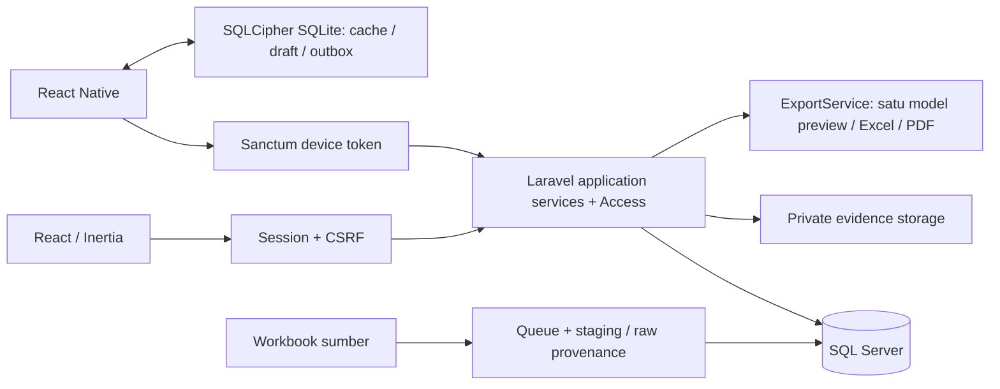
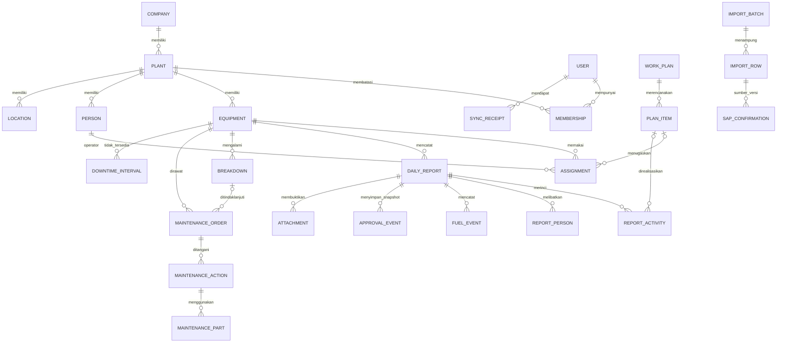

# Arsitektur implementasi EPITA

Pada source existing, web dan mobile memakai application services Laravel yang sama. Web memakai Inertia/session/CSRF, mobile memakai token perangkat. Pratinjau dokumen adalah fitur bisnis yang membaca data server. Backend dan environment perusahaan dikerjakan pengembang yang ditunjuk; source ini belum menjadi bukti implementasi di perusahaan. Lihat [handover backend](BACKEND-HANDOVER.md) dan [kontrak frontend](FRONTEND-CONTRACT.md).

Peta entry point/folder dan matriks 17 modul terbaru tersedia pada [audit final](FINAL-AUDIT.md); precedence dokumen pada [indeks](00-INDEX.md). Web memusatkan konversi waktu di `lib/time.ts`/`usePlantTime.ts` berdasarkan `plant.timezone`, termasuk input dua arah dan tanggal kerja terpisah. Transport tetap session/CSRF; mobile masih perlu menyesuaikan keputusan zona masing-masing plant.

## Definisi entitas pada source migrasi

Diagram ini menggambarkan schema yang ditemukan. Migrasi pada SQL Server perusahaan belum diverifikasi.

Seluruh FK menggunakan penghapusan terbatas. Nonaktif master mempertahankan transaksi. PK internal BIGINT dan public UUID dibedakan. Liter, meter, dan volume memakai DECIMAL(18,3). Durasi memakai detik integer; BCMath digunakan untuk kalkulasi transaksi. Timestamp disimpan UTC, work date disimpan terpisah, dan plant mempunyai zona waktu.

## Aturan bersama

- `Access` memeriksa membership aktif, company/plant aktif, role, dan permission di server.
- `ReportWorkflow` melakukan validasi, locking, version check, snapshot keputusan, verifikasi BBM, immutable final, serta pencatatan perubahan untuk pull.
- `PlanningService` mengunci alat dan operator, menolak benturan jadwal, dan memeriksa interval ketidaktersediaan.
- `MaintenanceService` menangani breakdown dan preventive/corrective WO secara terpisah dari VRA. Menutup satu WO tidak menutup blokir lainnya.
- `SyncService` menyimpan mutasi dan receipt dalam transaksi yang sama; user row dikunci untuk menyerialisasi replay serentak. Hash mencakup envelope operasi yang dikanonisasi. ID sama + hash berbeda menghasilkan 409.
- `WorkbookImporter` mempertahankan kolom mentah, provenance sheet/baris, dan masalah. `ParseWorkbook` memeriksa ulang kewenangan pelaksana job dan menyimpan versi konfirmasi SAP berdasarkan payload hash.
- `ExportService` menghasilkan model dokumen yang dipakai preview, XLSX, dan PDF. String Excel selalu ditulis sebagai string eksplisit; tanggal dan angka memakai tipe yang sesuai.

## Batas yang belum ditutup

Schema awal belum mencakup seluruh kamus data akhir PRD. Kalender/shift terkonfigurasi, ledger reset meter, amendment final, verified opening balance mesin, parameter estimasi berversi, alokasi SAP, cancellation links, reconciliation runs/resolutions, user/role administration, serta export jobs masih membutuhkan implementasi lanjutan. Status tersebut tidak dianggap selesai hanya karena menu referensinya tersedia.

Web menggunakan `WorkspaceData::screen` untuk daftar berpaginasi dan agregasi SQL periode lengkap. `snapshot` dipertahankan untuk kompatibilitas bootstrap mobile. `documentData` membaca hasil lengkap sesuai filter/izin, terpisah dari halaman layar dan tanpa batas 500/200/100 yang lama. Metadata total dan cutoff tersedia; referensi master untuk form tetap dimuat sesuai scope. Ekspor berukuran sangat besar masih memerlukan queue/streaming dan pengujian kapasitas pada SQL Server nyata.

## Rujukan teknis yang diperiksa

- [Laravel 13](https://laravel.com/docs/13.x/releases)
- [React/Inertia pada Laravel](https://laravel.com/docs/13.x/starter-kits)
- [Matriks driver Microsoft PHP SQL Server](https://learn.microsoft.com/en-us/sql/connect/php/microsoft-php-drivers-for-sql-server-support-matrix?view=sql-server-ver17)
- [Expo SQLite](https://docs.expo.dev/versions/latest/sdk/sqlite/)
- [Expo SecureStore](https://docs.expo.dev/versions/latest/sdk/securestore/)
- [Kompatibilitas Expo SDK 58](https://docs.expo.dev/versions/v58.0.0/)

Pembaruan 23 Oktober 2026: route `/preview/*`, akun/sesi role sintetis, generator fixture frontend dan mutasi localStorage dihapus. Satu-satunya penghapusan localStorage adalah key lama `epita.preview.v1`; cache/draft lain tidak disentuh. Pratinjau laporan bisnis tetap tersedia di `/workspace/report-preview` dengan data server. PDF tabel besar memakai `PdfTableWriter` melalui CPDF yang sudah tersedia dalam Dompdf; template pendek mempertahankan layout existing.
